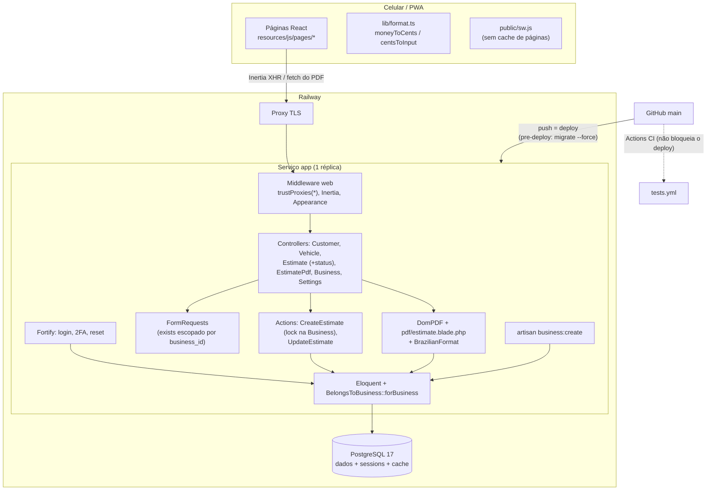
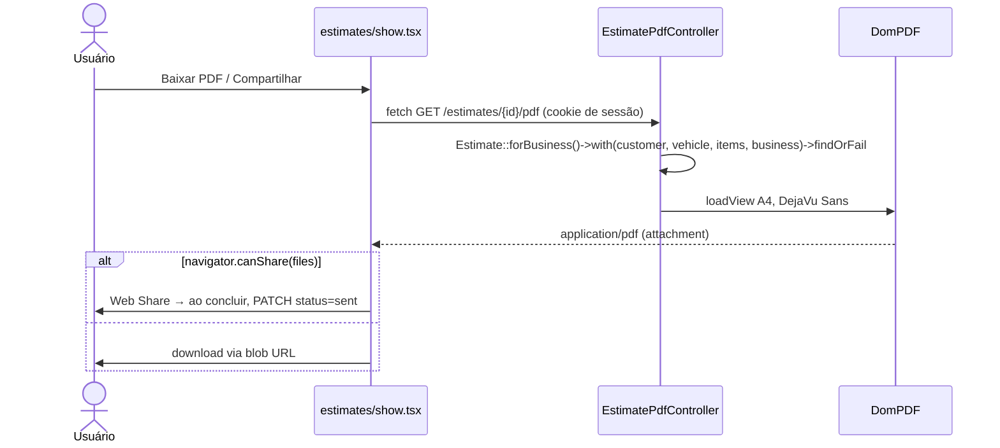
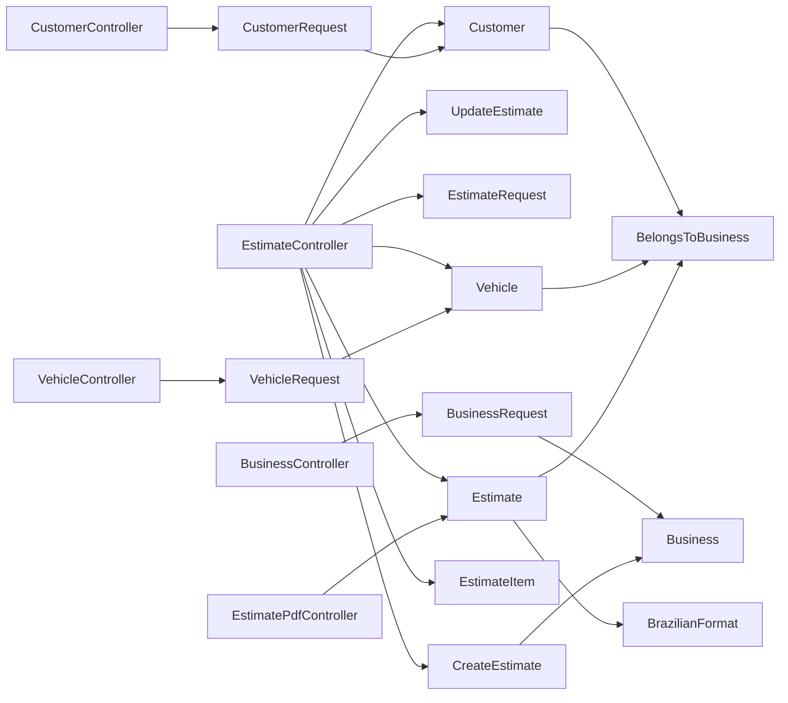

# 01 — Arquitetura atual

> Base: `origin/main` em `efebe2d` (2026-10-04), que é o que está em produção. O checkout local estava em `df32258`, 5 commits atrás. Os agentes da Fase 1 leram o checkout local, e a revisão R1 revalidou tudo contra `efebe2d` (ver [16-adversarial-review.md](16-adversarial-review.md)).

## 1. Resumo

Monólito Laravel 13 com SPA Inertia 3 + React 19, PostgreSQL 17 no Railway, uma réplica e deploy automático a cada push na `main`. Já é **multi-tenant por coluna** (`business_id`). O isolamento é explícito: o scope `forBusiness` + `findOrFail` em todo controller, sem global scope. Não há filas, jobs, scheduler, uploads nem integrações externas em runtime. O PDF é gerado na hora com DomPDF e não é salvo.

## 2. Stack e versões instaladas

| Camada                | Pacote                                                                          | Versão                           |
| --------------------- | ------------------------------------------------------------------------------- | -------------------------------- |
| Runtime               | PHP                                                                             | 8.5.4 (local) / 8.5 (CI)         |
| Framework             | laravel/framework                                                               | 13.31.0                          |
| SPA                   | inertiajs/inertia-laravel · @inertiajs/react                                    | 3.3.4 · 3.7.1                    |
| Auth                  | laravel/fortify                                                                 | 1.39.0                           |
| Rotas TS              | laravel/wayfinder                                                               | 0.1.21                           |
| PDF                   | barryvdh/laravel-dompdf                                                         | 3.1.2                            |
| UI                    | react · tailwindcss · Radix · lucide · sonner                                   | 19.3.0 · 4.3.3                   |
| Build                 | vite · vite-plus (`vp`)                                                         | 8.3.0 · 0.3.0                    |
| Testes                | pest · phpunit · larastan (level 0) · pint                                      | 5.2.0 · 13.3.3 · 3.12.1 · 1.32.1 |
| Sobras do starter kit | laravel/chisel, laravel/sail, nome `laravel/react-starter-kit` no composer.json | não usados                       |

Comandos usados: `composer show --direct` e `package-lock.json`.

## 3. Diagrama de arquitetura



Camadas: página React → Inertia → middleware → controller → FormRequest (validação + escopo) → Action (transação) → Eloquent → PostgreSQL. Não há Policies: a autorização é o próprio escopo `forBusiness`. Não há serviços, repositórios, eventos, observers, jobs ou notifications próprias.

## 4. Mapa de rotas (efebe2d)

| Método e rota                                   | Controller                  | Observação                                                           |
| ----------------------------------------------- | --------------------------- | -------------------------------------------------------------------- |
| `GET /dashboard`                                | closure em `routes/web.php` | 5 últimos orçamentos + onboarding                                    |
| `GET /manifest.webmanifest`                     | closure                     | manifest da PWA gerado de `config/brand.php`                         |
| `resource /customers` (sem destroy)             | `CustomerController`        | busca `?search=` em nome/telefone                                    |
| `/vehicles` create/store/edit/update            | `VehicleController`         | redireciona para o cliente                                           |
| `resource /estimates` (sem destroy)             | `EstimateController`        | `create?customer_id=&vehicle_id=&duplicate=`; `index?vehicle_id=`    |
| `PATCH /estimates/{id}/status`                  | `EstimateController@status` | draft ⇄ sent                                                         |
| `GET /estimates/{id}/pdf`                       | `EstimatePdfController`     | download `orcamento-NNN.pdf`                                         |
| `GET/PUT /settings/business`                    | `BusinessController`        | dados da oficina no PDF                                              |
| `/settings/profile`, `/security`, `/appearance` | `Settings\*`                | inclui `DELETE settings/profile`                                     |
| Fortify                                         | vendor                      | login, logout, 2FA, forgot/reset, confirm password; **sem** register |

## 5. Fluxos end-to-end

### 5.1 Criar/editar orçamento

```mermaid
sequenceDiagram
    actor U as Usuário
    participant P as estimates/form.tsx
    participant E as EstimateController
    participant R as EstimateRequest
    participant A as CreateEstimate / UpdateEstimate
    participant DB as PostgreSQL
    U->>P: GET /estimates/create[?customer_id|vehicle_id|duplicate]
    P->>E: create()
    E->>DB: todos os clientes e veículos da oficina + itemSuggestions (100 descrições)
    E-->>P: props (selectedCustomerId, selectedVehicleId, duplicateOf)
    U->>P: cliente, veículo, data, itens em R$
    P->>P: transform: amount = moneyToCents(texto)
    P->>E: POST /estimates ou PUT /estimates/{id}
    E->>R: exists escopado; 1..100 itens; amount inteiro 1..999999999; after(): veículo pertence ao cliente
    alt criar
        E->>A: CreateEstimate
        A->>DB: BEGIN; SELECT businesses FOR UPDATE; max(number)+1; INSERT estimate; INSERT itens; COMMIT
    else editar
        E->>DB: Estimate::forBusiness()->findOrFail(id)
        E->>A: UpdateEstimate
        A->>DB: BEGIN; [lock no orçamento, após lote 2]; UPDATE estimate (total); DELETE itens; INSERT itens; COMMIT
    end
    E-->>P: flash toast + 302 estimates.show
```

### 5.2 PDF e compartilhamento



### 5.3 Login

Fortify com página Inertia `auth/login`. Limite de 5 tentativas por minuto por `email|ip` (`FortifyServiceProvider`). 2FA TOTP opcional. Sessão em banco, com 30 dias por padrão desde `aa40e18`. O `verified` do grupo de rotas não tem efeito, porque `User` não implementa `MustVerifyEmail`.

### 5.4 Onboarding de oficina

Não há cadastro público. A oficina e o primeiro usuário são criados por `php artisan business:create` (SSH ou Railway shell). Não há comando para adicionar um segundo usuário.

## 6. Inventário técnico

| Item                | Situação                                                                                            | Evidência                             |
| ------------------- | --------------------------------------------------------------------------------------------------- | ------------------------------------- |
| Jobs, filas         | Nenhum. As tabelas `jobs`/`failed_jobs` existem, mas não são usadas                                 | `config/queue.php`, sem `ShouldQueue` |
| Scheduler           | Nenhum                                                                                              | `routes/console.php`                  |
| E-mail              | Só o reset de senha do Fortify. `MAIL_MAILER` padrão é `log`, sem `MAIL_*` em `.railway/railway.ts` | **não verificado em produção**        |
| Arquivos            | Nenhum upload. PDF não persistido. Disco do Railway efêmero                                         | `docs/railway.md`                     |
| HTTP externo        | Nenhum. DomPDF com `enable_remote=false`                                                            | vendor config                         |
| Observabilidade     | Logs em stderr. Sem APM/Sentry. `/up` não testa o banco                                             | `bootstrap/app.php`                   |
| Tratamento de erros | Handler padrão. Front: toast para ≥500 e erro de rede. 4xx/419 caem no modal HTML do Inertia        | `use-flash-toast.ts`                  |

## 7. CI/CD e ambiente

- **CI** (`.github/workflows/tests.yml`): `composer setup` e depois `composer ci:check` (vp check, tsc, pint, phpstan level 0, Pest). **Estava quebrado em todo push** (ver [04-technical-audit.md](04-technical-audit.md) T01): o `setup` roda `migrate` contra o Postgres `127.0.0.1:5434` do `.env.example`, que não existe no runner. Corrigido no lote 1 ([14-implementation-log.md](14-implementation-log.md)).
- **CD:** o Railway publica a cada push na `main`, em paralelo ao CI e **sem esperar por ele**. Pre-deploy: `php artisan migrate --force`. Healthcheck em `/up`.
- **Dev:** `docker-compose.yml` sobe Postgres 17 em `localhost:5434`. **Atenção:** nesta máquina a porta 5434 está ocupada pelo container de outro projeto (`escalas-louvor-db-1`), então um `php artisan migrate` local cairia no banco errado. Os testes usam sqlite `:memory:` (`phpunit.xml`).

## 8. Mapa de dependências internas



Evidência detalhada (arquivo:linha) nos relatórios dos agentes, em [agents/](agents/).
