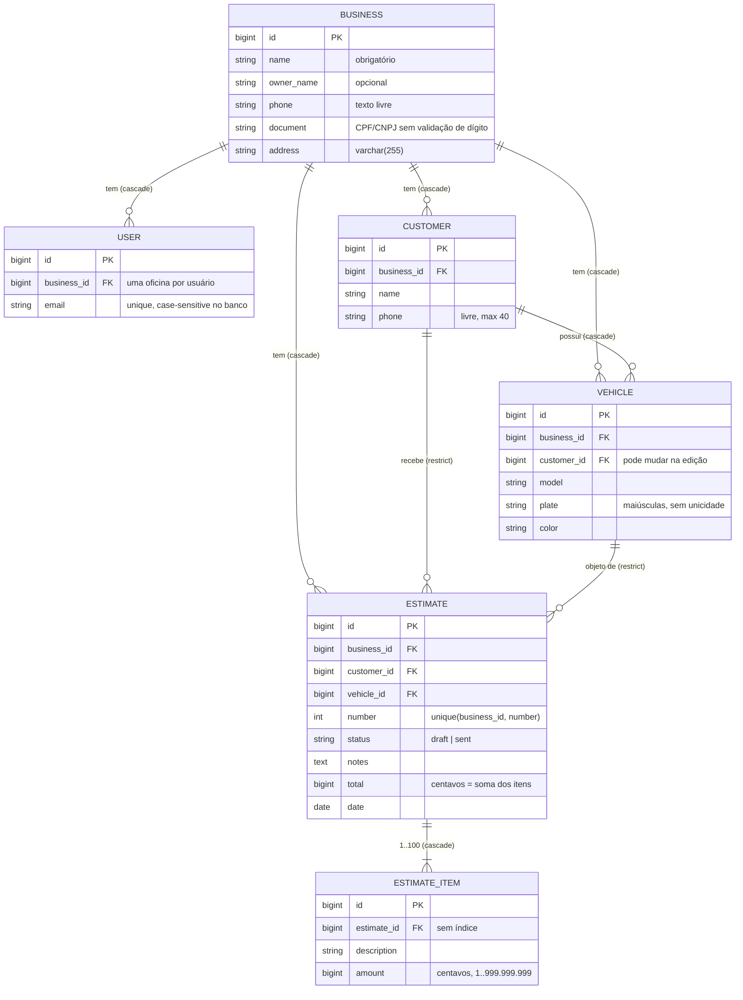
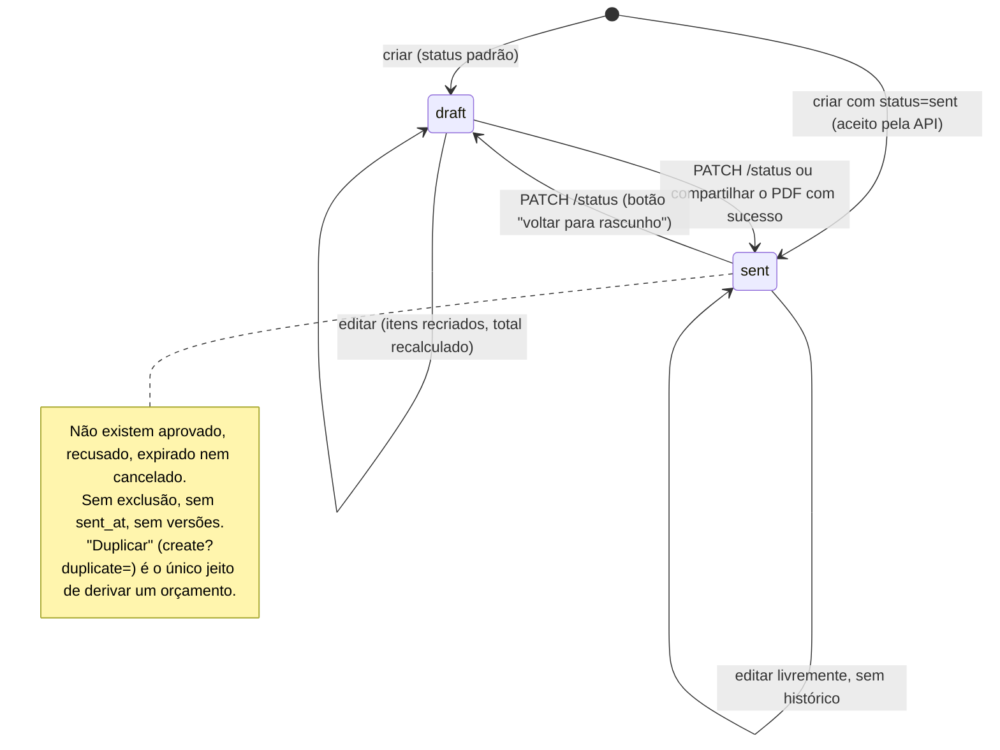

# 02 — Modelo de domínio

Fonte: [agents/domain-analyst.md](agents/domain-analyst.md), revalidado em `efebe2d` na R1.

## 1. Entidades e relações

O item não tem quantidade, preço unitário, tipo (peça ou mão de obra) nem posição. O orçamento não guarda cópia dos dados de cliente e veículo: um PDF reemitido mostra os dados atuais.

## 2. Ciclo de vida do orçamento (efebe2d)

## 3. Invariantes

| #   | Invariante                                                  | Onde é garantida                                     | Nível                                         |
| --- | ----------------------------------------------------------- | ---------------------------------------------------- | --------------------------------------------- |
| I1  | Todo registro lido ou escrito pertence à oficina do usuário | `forBusiness` + `findOrFail` em todos os controllers | App                                           |
| I2  | `business_id`, `number` e `total` nunca vêm do request      | `validated()` sem esses campos; `CreateEstimate`     | App                                           |
| I3  | Cliente e veículo do orçamento são da mesma oficina         | `Rule::exists(...)->where('business_id')`            | App (sem FK composta)                         |
| I4  | O veículo pertence ao cliente do orçamento                  | `EstimateRequest::after()`                           | App, **só na gravação do orçamento**          |
| I5  | `total = Σ amount`, em centavos inteiros                    | `CreateEstimate`, `UpdateEstimate`                   | App + transação                               |
| I6  | Número sequencial por oficina, sem duplicata                | lock na `businesses` + `unique(business_id, number)` | App + banco (testado: 8 processos × 50 em PG) |
| I7  | 1 a 100 itens; `amount` inteiro de 1 a 999.999.999          | `EstimateRequest`                                    | App                                           |
| I8  | Status ∈ {draft, sent}                                      | `EstimateRequest`, `EstimateController@status`       | Só app (sem CHECK)                            |
| I9  | Cliente ou veículo com orçamento não pode ser apagado       | FK `restrict`                                        | Banco                                         |
| I10 | Nada de negócio é excluído pela UI                          | sem rotas `destroy`                                  | Rotas                                         |

**Invariantes não garantidas:**

- I4 deixa de valer quando o veículo muda de dono (D1).
- O total pode divergir dos itens sob edição concorrente (T04, corrigido no lote 2).
- A oficina pode ficar sem nenhum usuário (S01).
- A ordem dos itens não tem garantia contratual (corrigido no lote 2 com `orderBy('id')`).

## 4. Ambiguidades de negócio (dependem do cliente/produto)

| #   | Pergunta                                                                                              | Impacto se ficar indefinido                                                  |
| --- | ----------------------------------------------------------------------------------------------------- | ---------------------------------------------------------------------------- |
| D1  | O veículo pode trocar de dono? Se sim, o orçamento antigo deve guardar cópia do cliente e do veículo? | Hoje o orçamento antigo passa a mostrar um par cliente/veículo inconsistente |
| D2  | Um orçamento "Enviado" pode ser editado? Ou só duplicado (nova versão)?                               | O mesmo nº pode ter dois conteúdos já entregues ao cliente                   |
| D3  | Precisa de aprovado, recusado e expirado? Validade em dias?                                           | Sem acompanhamento comercial                                                 |
| D4  | Os itens precisam de quantidade × unitário, tipo peça/mão de obra, desconto?                          | Hoje vira texto livre (o seeder já escreve "Mão de obra")                    |
| D5  | A placa é única por oficina? Precisa normalizar o hífen?                                              | Veículos duplicados, busca fragmentada                                       |
| D6  | O que acontece quando o último usuário apaga a conta?                                                 | Oficina órfã e inacessível                                                   |
| D7  | Trabalha com seguradora (sinistro, franquia)?                                                         | Campos ausentes                                                              |

Essas perguntas estão consolidadas em [17-next-steps.md](17-next-steps.md).
