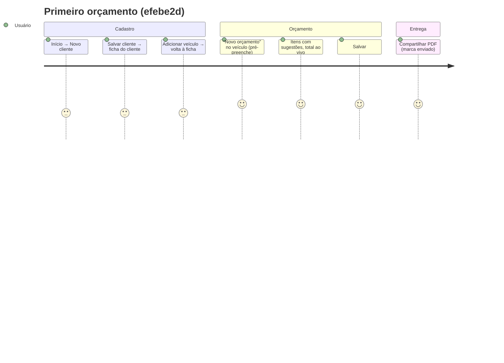

# 07 — Revisão de UX e produto

Fonte: [agents/product-designer.md](agents/product-designer.md), baseado em `df32258`. Revisto contra `efebe2d`: o commit `efebe2d` ("melhorias da avaliação heurística") e o `faec511` já resolveram vários pontos, marcados abaixo. Teste em navegador (Chrome, viewport 375×812) feito em 2026-10-19 na worktree, com dados do `DemoSeeder` num PostgreSQL local.

## Jornada principal: primeiro orçamento de um cliente novo

Cerca de 7 telas. Desde o `faec511` o orçamento parte do veículo já selecionado, o que encurtou o caminho. O cadastro de cliente e de veículo dentro do formulário (inline) continua ausente.

## Situação dos achados de UX

| ID    | Sev.  | Achado                                                                                                      | Situação em efebe2d / após a missão                                         |
| ----- | ----- | ----------------------------------------------------------------------------------------------------------- | --------------------------------------------------------------------------- |
| UX01  | P1→ok | Novo orçamento pré-selecionava o 1º cliente e o veículo (risco de enviar para o cliente errado)             | **Corrigido no origin** (`faec511`)                                         |
| UX02  | P1→ok | Jornada cliente → orçamento quebrada (sem botão na ficha, `customer_id` ignorado)                           | **Corrigido no origin** (`customers/show.tsx:112`)                          |
| UX03  | P1→P2 | Rascunho perdido ao sair do formulário                                                                      | **Mitigado no origin** (`use-unsaved-changes` avisa); não há autosave       |
| UX04  | P2→ok | Status "Enviado" inacessível na UI                                                                          | **Corrigido no origin** (botões + share marca enviado)                      |
| UX05  | P2→ok | Data padrão em UTC                                                                                          | **Corrigido** (lote 3)                                                      |
| UX06  | P2→ok | PDF com sessão expirada salva HTML                                                                          | **Corrigido** (lote 3)                                                      |
| UX07  | P2→ok | Erros de validação sem foco                                                                                 | **Corrigido no origin** (`lib/form-errors.ts` foca o 1º erro)               |
| UX08  | P2    | Borda dos inputs com contraste 1,49:1 (claro) e 1,68:1 (escuro); a WCAG 1.4.11 pede 3:1                     | **Aberto**, `app.css:112,160`; é mudança visual, não aplicada sem aprovação |
| UX09  | P2    | 4xx/419 sem toast pt-BR                                                                                     | Aberto (T14)                                                                |
| UX10  | P2    | Busca por telefone depende da máscara digitada                                                              | Aberto (normalizar dígitos exige migration de dados)                        |
| UX11  | P3    | Valor "1,999" truncado em silêncio para 1,99                                                                | Aberto; o campo reformata no blur, o que atenua                             |
| UX12  | P3    | Alvos de toque de 36px (remover item, links)                                                                | Aberto                                                                      |
| UX13  | P3    | `<select>` nativo com todos os clientes (ruim com centenas)                                                 | Aberto (P-03)                                                               |
| UX14  | P3    | Share marca "Enviado" quando o `navigator.share` resolve, mesmo se a pessoa não enviar a mensagem (R1-N5)   | Aberto: comportamento escolhido no origin; documentado                      |
| UX15  | P3    | Ícone da PWA só em SVG (o iOS não usa SVG no `apple-touch-icon`)                                            | **Não verificado** em iPhone                                                |
| UX-H1 | P3?   | iOS: `navigator.share` depois de um `await fetch` lento pode perder a ativação do toque (`NotAllowedError`) | **Hipótese**; o PDF 97% menor (lote 2) reduz a janela; testar em aparelho   |

## O que funciona bem

- Dupla submissão bloqueada (`Button loading`, `aria-busy`).
- `inputMode="decimal"`, total ao vivo com `aria-live`, `enterKeyHint="next"` nos itens.
- `Field` liga label, `aria-describedby` e `aria-invalid`.
- Estados vazios com ação, onboarding no dashboard, toasts em pt-BR.
- Contraste de texto ≥ 5:1 nos dois temas.

## Verificado no navegador (2026-10-19)

| Verificação                                        | Resultado                                                |
| -------------------------------------------------- | -------------------------------------------------------- |
| Login, dashboard e formulário de orçamento a 375px | OK, uma coluna, barra de total fixa e navegação inferior |
| Data padrão do formulário                          | Data local (19/10/2026)                                  |
| Valor "-10,00" no item                             | Total exibe R$ 0,00; antes viraria R$ 10,00              |
| `fetch` do PDF com sessão                          | `application/pdf`, 23.354 bytes                          |
| `fetch` do PDF sem sessão                          | `redirected: true`, 200, `text/html` → agora tratado     |

Não testado: iPhone/Safari real, Android real com teclado aberto, leitor de tela.
