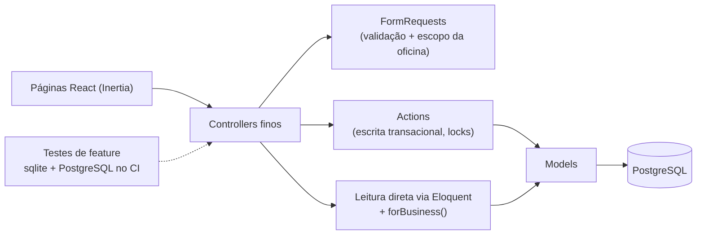

# 10 — Opções de arquitetura

## Necessidades que a arquitetura precisa atender (verificadas)

1. Criar e enviar orçamentos rápido pelo celular, com total correto e PDF leve.
2. Confiabilidade: deploy automático sem regressão silenciosa.
3. Isolamento entre oficinas, que já existe e precisa continuar provado.
4. Evoluir o fluxo (status, versões, validade) sem reescrever.
5. Poder receber mais oficinas sem mudar a base de dados.

Não há evidência de necessidade de filas, microserviços, event sourcing, API pública ou app nativo.

## Cenários

### A. Evolução conservadora

Manter a estrutura atual (controllers finos, FormRequests, Actions para escrita transacional) e evoluir por features pequenas, cada uma com teste.

### B. Modularização progressiva orientada ao domínio

Agrupar o código por contexto (`app/Domain/Estimates`, `app/Domain/Customers`...), com DTOs, serviços de domínio, eventos e enums ricos.

### C. Preparação para multi-tenancy/SaaS

Global scope ou pacote de tenancy (stancl/tenancy), papéis, planos, cobrança e roteamento por subdomínio.

## Comparação

| Critério                    | A. Conservadora          | B. Modular                                                   | C. SaaS agora                                    |
| --------------------------- | ------------------------ | ------------------------------------------------------------ | ------------------------------------------------ |
| Custo de mudança            | Baixo, incremental       | Médio–alto (mover ~30 arquivos, reescrever imports e testes) | Alto (todas as rotas, auth, PWA, infraestrutura) |
| Complexidade adicionada     | Nenhuma                  | Camadas para um domínio de 6 tabelas                         | Muito alta                                       |
| Isolamento entre oficinas   | Mantido (scope + testes) | Igual ao A                                                   | Maior em teoria; hoje já está correto            |
| Manutenção por 1 dev        | Ótima                    | Pior até o domínio crescer                                   | Pior                                             |
| Testes                      | Feature tests diretos    | Mais unitários de serviço, mais mocks                        | Matriz de tenants/planos                         |
| Deploy (push = produção)    | Sem risco extra          | Refatoração grande num push só                               | Migrations grandes rodando sozinhas em produção  |
| Risco                       | Baixo                    | Médio (regressão sem ganho funcional)                        | Alto                                             |
| Atende às necessidades 1–5? | Sim                      | Sim, com custo                                               | Sim, com custo muito maior                       |

## Recomendação: A, com três preparações pontuais

A arquitetura-alvo mais simples é **a atual**, com pequenos ajustes e nenhuma camada nova.

1. **Actions como fronteira de escrita**: toda escrita com regra de negócio (criar, editar, mudar status, duplicar, versionar) vai para `app/Actions`, como já é feito com `CreateEstimate`/`UpdateEstimate`. Hoje `EstimateController@status` escreve direto; quando ganhar regra (ex.: `sent_at`), deve virar Action.
2. **Status como enum PHP** (`EstimateStatus: Draft, Sent`) **quando** surgir o terceiro estado (aprovado/recusado). Hoje `'draft'`/`'sent'` aparece em dois lugares do PHP e em cerca de cinco do front (`form.tsx`, `show.tsx`); ainda não justifica mudança isolada.
3. **Rede de segurança do isolamento**: um teste que percorre as rotas autenticadas com ids de outra oficina. Fica mais barato que global scope e protege endpoints futuros.

Modularização (B) só faz sentido se o domínio passar de ~15 tabelas ou houver mais de um time. SaaS (C) segue em [09-saas-readiness.md](09-saas-readiness.md), com gatilhos explícitos.

## Decisões imediatas × adiadas

| Imediatas (feitas ou de baixo custo)      | Adiadas (com gatilho)                                   |
| ----------------------------------------- | ------------------------------------------------------- |
| CI com PostgreSQL (ADR-001)               | Enum de status → quando houver 3º estado                |
| Lock pessimista na edição (ADR-002)       | Snapshot/versão do orçamento → decisão D1/D2            |
| Índices de FK (ADR-003)                   | Paginação → volume real > ~500 orçamentos               |
| Manter tenancy por coluna (ADR-004)       | Papéis/planos/cobrança → gatilhos do doc 09             |
| PDF síncrono, sem armazenamento (ADR-005) | Fila para PDF → só se o tempo de geração passar de ~2 s |
