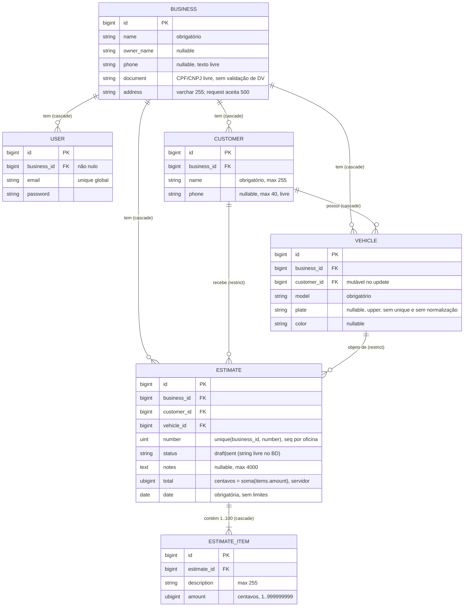

# Domain Analyst: domínio de orçamentos (Tratto/Orçamentos)

Data: 2026-10-19. Commit analisado: `df32258` (main). Modo: somente leitura. Experimentos em
`scratchpad/domain/DomainProbeTest.php`, executado com `vendor/bin/pest <arquivo>` (sqlite em memória, 10 sondas).

> Incidente operacional: ao preparar a sonda, um comando meu copiou por engano o arquivo de teste para
> `tests/Feature/ZzDomainProbeTest.php`. Removi o arquivo logo em seguida, sem rodá-lo de dentro do repositório.
> `git status` confirmou que voltou ao estado inicial (só `?? .omc/`).

## 1. Escopo investigado

- Docs: `CLAUDE.md`, `docs/sistema.md`.
- Migrations: `database/migrations/0001_01_01_000000_create_users_table.php` (businesses/users) e `2026_09_14_00000{1..4}` (customers, vehicles, estimates, estimate_items).
- Models: `Business`, `User`, `Customer`, `Vehicle`, `Estimate`, `EstimateItem` e o trait `Concerns/BelongsToBusiness`.
- Actions: `CreateEstimate`, `UpdateEstimate`. Requests: `Business`, `Customer`, `Vehicle` e `EstimateRequest`.
- Controllers: `Customer`, `Vehicle`, `Estimate`, `EstimatePdf`, `Business` e `Settings/ProfileController` (exclusão de conta). Também `routes/web.php`.
- PDF: `resources/views/pdf/estimate.blade.php`. Frontend: `resources/js/lib/format.ts`, `pages/estimates/form.tsx`, `pages/business/edit.tsx` e `components/estimate-list-item.tsx`.
- Testes existentes: `tests/Feature/EstimateTenantTest.php` (lista de casos).

Fora do escopo: autenticação, 2FA, PWA, deploy, desempenho e segurança aprofundada.

## 2. Modelo de domínio

```mermaid
stateDiagram-v2
    [*] --> draft: store (status escolhido no form; padrão draft)
    [*] --> sent: store com status=sent (permitido)
    draft --> draft: update (itens recriados, total recalculado)
    draft --> sent: update status=sent (manual; compartilhar o PDF NÃO muda o status)
    sent --> sent: update livre (itens/valores/cliente mudam sem histórico)
    sent --> draft: update status=draft (permitido, sem trilha)
    note right of sent
        Não existem aprovado, recusado, expirado ou cancelado.
        Não existe exclusão (sem rota destroy).
        Não há sent_at nem versões.
    end note
```

### Invariantes implementadas (onde)

| #   | Invariante                                                                        | Onde é garantida                                                                                                                                  | Nível                             |
| --- | --------------------------------------------------------------------------------- | ------------------------------------------------------------------------------------------------------------------------------------------------- | --------------------------------- |
| I1  | Registro pertence à oficina do usuário (leitura/escrita)                          | `forBusiness` em `CustomerController.php:17,40,47,54`, `VehicleController.php:42,51`, `EstimateController.php:65`, `EstimatePdfController.php:14` | App                               |
| I2  | `business_id` nunca vem do request                                                | `CustomerController.php:32`, `VehicleController.php:30`, `CreateEstimate.php:22` (sonda P4 ok)                                                    | App                               |
| I3  | FK de cliente/veículo do orçamento é da mesma oficina                             | `EstimateRequest.php:20-21`, `VehicleRequest.php:17` (`Rule::exists ... where business_id`)                                                       | App (sem FK composta no BD)       |
| I4  | Veículo pertence ao cliente do orçamento                                          | `EstimateRequest.php:34-44` (`after()`); sonda P1 ok                                                                                              | App, **só no momento da escrita** |
| I5  | `total = Σ items.amount` em centavos; o total do cliente é ignorado               | `CreateEstimate.php:17`, `UpdateEstimate.php:15`; sonda P4 ok                                                                                     | App + transação                   |
| I6  | Número sequencial por oficina, sem duplicidade                                    | `CreateEstimate.php:15-16` (lock + max+1) e `unique(business_id, number)` em `..._create_estimates_table.php:24`                                  | App + BD                          |
| I7  | `number` e `business_id` imutáveis no update                                      | não estão nas regras de `EstimateRequest`, logo ficam fora de `validated()`                                                                       | App                               |
| I8  | 1 a 100 itens, `amount` inteiro de 1 a 999.999.999                                | `EstimateRequest.php:26-28`; `150.5` é rejeitado (sonda P7)                                                                                       | App                               |
| I9  | Status ∈ {draft, sent}                                                            | `EstimateRequest.php:23`                                                                                                                          | Só app (coluna `string` livre)    |
| I10 | Itens somem com o orçamento; cliente/veículo com orçamento não podem ser apagados | `..._estimate_items_table.php:14` (cascade), `..._estimates_table.php:15-16` (restrict)                                                           | BD                                |
| I11 | Nada é excluído pela UI                                                           | `routes/web.php:46-48` (sem destroy)                                                                                                              | Rotas                             |

### Invariantes NÃO garantidas

- I4 deixa de valer depois da gravação, porque o veículo pode mudar de dono (A1).
- Não há FK composta `(business_id, customer_id)`: o isolamento entre oficinas depende 100% da aplicação (A9).
- O status não tem `CHECK` no BD nem enum PHP.
- A ordem dos itens não é garantida (A7).
- Uma oficina sempre ter ao menos um usuário (A4).

## 3. Achados confirmados

| ID  | Sev.   | Achado                                                                                                                                                                                                                                                                  | Evidência                                                                                                                                                                       | Impacto                                                                    | Confiança                                                 | Esforço                                                       |
| --- | ------ | ----------------------------------------------------------------------------------------------------------------------------------------------------------------------------------------------------------------------------------------------------------------------- | ------------------------------------------------------------------------------------------------------------------------------------------------------------------------------- | -------------------------------------------------------------------------- | --------------------------------------------------------- | ------------------------------------------------------------- |
| A1  | **P2** | Ao mover um veículo para outro cliente, os orçamentos existentes ficam inconsistentes: o cliente do orçamento ≠ o dono do veículo, e o PDF mostra o cliente antigo com o veículo agora de outro.                                                                        | `VehicleController.php:49-53` aceita `customer_id` (`VehicleRequest.php:17`); I4 só existe em `EstimateRequest.php:34-44`. Sonda P2: `estimate_customer=1, vehicle_customer=2`. | Dados históricos incoerentes; o PDF reemitido mente sobre o vínculo.       | Alta (reproduzido)                                        | P                                                             |
| A2  | **P2** | Endereço da oficina: a validação aceita até 500 caracteres, mas a coluna é `varchar(255)`. No PostgreSQL, um texto com mais de 255 caracteres gera erro 500 (`22001 value too long`), não erro de validação.                                                            | `BusinessRequest.php:21` vs `create_users_table.php:20`. Sonda P10 passou com 400 caracteres só porque o SQLite não impõe tamanho.                                              | Página quebra em produção com endereço longo.                              | Alta (por schema; não rodado em PG)                       | P (alterar regra para max:255, ou nova migration para `text`) |
| A3  | **P2** | Status sem regra de transição: dá para criar já como `sent`, voltar `sent→draft` e editar itens/valores/cliente de um orçamento enviado, sem histórico, `sent_at` ou versão. O número é mantido, então o mesmo "Nº 001" pode ter dois conteúdos já enviados ao cliente. | `EstimateRequest.php:23`, `UpdateEstimate.php:12-20`. Sonda P3: `sent` virou `draft`, total 15000→99, number=1.                                                                 | Disputa com o cliente ("o orçamento que recebi era outro"); sem auditoria. | Alta                                                      | M (regra de negócio a decidir)                                |
| A4  | **P2** | O último usuário pode excluir a própria conta e deixar a oficina órfã: Business, clientes e orçamentos permanecem sem ninguém que acesse; recriar pelo comando gera **outra** oficina.                                                                                  | `Settings/ProfileController.php:51-63`; `users.business_id` cascade só na direção Business→User. Sonda P5: `users_left=0, business_exists=true, customers=2`.                   | Perda de acesso aos dados; suporte manual no banco.                        | Alta                                                      | P (bloquear exclusão do último usuário)                       |
| A5  | **P2** | A data padrão do novo orçamento sai em UTC: `new Date().toISOString().slice(0,10)`. No Brasil (UTC-3), entre 21h e 24h, o orçamento nasce com a data de **amanhã**.                                                                                                     | `resources/js/pages/estimates/form.tsx:59`; `config/app.php:68` timezone UTC.                                                                                                   | Data errada no PDF se o usuário não notar.                                 | Alta (por raciocínio; trivial de reproduzir com fuso BRT) | P                                                             |
| A6  | P3     | Placa sem normalização nem unicidade: `abc1234`, `ABC1234` e `ABC-1234` coexistem na mesma oficina, até para clientes diferentes. A busca por placa com hífen não encontra a placa sem hífen.                                                                           | `VehicleController.php:30,52` (só `strtoupper`), `create_vehicles_table.php:19` (index não único). Sonda P6.                                                                    | Duplicidade de veículo e histórico fragmentado.                            | Alta                                                      | P–M (decisão de negócio: a placa é única por oficina?)        |
| A7  | P3     | Itens sem coluna de posição: `Estimate::items()` não tem `orderBy`, e no PostgreSQL a ordem sem ORDER BY não é garantida (na prática segue o id, porque o update apaga e recria).                                                                                       | `Estimate.php:33-36`, `..._estimate_items_table.php`.                                                                                                                           | Ordem dos itens no PDF pode variar.                                        | Média (plausível; não observado)                          | P                                                             |
| A8  | P3     | Entrada de dinheiro trunca casas extras em silêncio: `"1,999"` vira 199 centavos, e `"1.2345"` vira 123. O usuário vê o valor reformatado no blur (`form.tsx:359-360`), o que atenua o problema.                                                                        | `resources/js/lib/format.ts:34` (`slice(0, 2)`).                                                                                                                                | Valor diferente do digitado.                                               | Alta (por leitura)                                        | P                                                             |
| A9  | P3     | Isolamento entre oficinas sem defesa em profundidade no BD: `estimates.customer_id`/`vehicle_id` e `vehicles.customer_id` aceitam ids de outra oficina se algum caminho futuro esquecer o `Rule::exists ... where`.                                                     | `create_estimates_table.php:15-16`, `create_vehicles_table.php:15`.                                                                                                             | Risco latente, sem exploração hoje.                                        | Alta (estrutural)                                         | M                                                             |
| A10 | P3     | Data sem limites: `1900-01-01` e `2999-12-31` são aceitas.                                                                                                                                                                                                              | `EstimateRequest.php:22`; sonda P8.                                                                                                                                             | Erro de digitação vira documento.                                          | Alta                                                      | P                                                             |

Sem problema (verificado):

- Override de `number`, `total` e `business_id` é ignorado (P4).
- Valor decimal em string é rejeitado (P7).
- O total máximo (100 × 999.999.999 = 99.999.999.900 centavos) cabe em `unsignedBigInteger` e em `Number` do JS (P7).
- A corrida na numeração é coberta pelo lock + unique.

## 4. Hipóteses não verificadas

- H1: no PostgreSQL, excluir uma `Business` (não há rota para isso hoje) pode falhar. `estimates.customer_id` é `ON DELETE RESTRICT`, checado de imediato, enquanto `customers` cai por cascade da mesma Business. O resultado depende da ordem das cascatas. Só importa se um dia existir exclusão de oficina.
- H2: `UpdateEstimate` não trava a linha. Duas edições simultâneas resultam em "a última vence", mas itens e total ficam coerentes dentro de cada transação. Baixo risco.
- H3: `Customer::phone` e `Business::document` são texto livre (sem validação de DV de CPF/CNPJ). `BrazilianFormat::formatDocument` exibe só os dígitos quando o tamanho não bate, então o PDF pode mostrar documento inválido.

## 5. Ambiguidades de negócio (decisões pendentes)

1. **Ciclo de vida:** faltam estados de aprovação/recusa/expiração? "Enviado" deve congelar o orçamento (exigir duplicar ou versionar para alterar)? Compartilhar o PDF deveria marcar como `sent`?
2. **Validade do orçamento:** não há `valid_until` nem texto de validade no PDF.
3. **Itens:** não distinguem serviço de peça e não têm quantidade nem preço unitário. Não há desconto nem itens de valor zero (cortesia), porque `amount min:1` impede.
4. **Veículo:** pode trocar de dono? Se sim, o orçamento deve guardar um snapshot de cliente/veículo (nome, placa, modelo), já que hoje o PDF lê os dados atuais. O mesmo vale para renomear cliente ou trocar a placa: o PDF antigo reemitido muda.
5. **Placa:** única por oficina? Normalizar formato Mercosul/antigo e remover hífen?
6. **Numeração:** pode haver lacuna (número de orçamento descartado)? Hoje não há exclusão, então não há lacuna, mas também não há cancelamento.
7. **Data:** é a data de emissão ou a do serviço? Deve aceitar datas futuras ou passadas?
8. **Multiusuário:** não há papéis (dono/funcionário), e qualquer usuário edita tudo, inclusive os dados da oficina.

## 6. Recomendações (por prioridade)

1. A2: alinhar `BusinessRequest` `address` para `max:255` (sem migration) ou criar uma nova migration para `text`. Correção trivial que evita erro 500.
2. A1: escolher entre (a) impedir troca de `customer_id` de veículo que já tem orçamento, ou (b) guardar um snapshot de cliente/veículo no orçamento. A opção (a) é a mais barata.
3. A3: definir uma política mínima, por exemplo bloquear edição de `sent` ou registrar `sent_at` e um histórico simples. Antes disso, decidir com o produto.
4. A4: impedir a exclusão do último usuário da oficina, com mensagem em pt-BR.
5. A5: gerar a data padrão com o fuso local (`toLocaleDateString('sv-SE')` ou montar com `getFullYear/Month/Date`), ou definir o default no servidor com o fuso `America/Sao_Paulo`.
6. A6, A7, A8 e A10: normalizar a placa (remover não-alfanuméricos), avaliar unique parcial, adicionar `position` ou `orderBy('id')` nos itens, rejeitar mais de 2 casas decimais na UI e limitar a data (`after:2000-01-01`, `before:+1 year`).

## 7. Testes necessários

- Veículo com orçamento: tentar mudar `customer_id` deve ser rejeitado (ou o snapshot preservado), conforme a decisão de A1.
- `PUT /settings/business` com `address` de 256+ caracteres deve retornar erro de validação, não 500. Idealmente rodar no CI com PostgreSQL, porque o SQLite mascara o problema.
- Exclusão de conta do último usuário deve ser recusada; com dois usuários, deve ser permitida.
- Transições de status conforme a política definida (sent→draft, editar sent).
- Ordem dos itens preservada após update.
- Teste de unidade JS de `moneyToCents` para `"1,999"`, `"1.2345"`, `"1.000,50"` e `"10.5"`.
- Data padrão do formulário com fuso BRT após 21h (teste de frontend, ou mover o default para o servidor e testar em Pest).

## 8. Riscos e limitações

- As sondas rodaram em SQLite. A2 e H1 dependem de comportamento do PostgreSQL e não foram executadas lá (não acessei o banco local nem a produção).
- A5 e A8 foram confirmados por leitura de código, sem execução no navegador.
- Não li `docs/manual-test.md`, as páginas `show/index` inteiras, nem os testes de Settings.

## 9. Perguntas para outros agentes

- **Security/tenant:** existe algum outro endpoint (ou futuro endpoint de API/MCP) que monte `Estimate`/`Vehicle` sem `Rule::exists ... where business_id`? Isso reforça A9.
- **QA/CI:** o CI (`.github/workflows/tests.yml`) roda com SQLite ou PostgreSQL? Se for SQLite, A2 e classes parecidas de bug passam despercebidas.
- **Produto/UX:** a ação "Compartilhar" (`pages/estimates/show.tsx:88-100`) deveria marcar `sent`? O PDF deveria mostrar o status ou "RASCUNHO"?
- **Data/infra:** há, em produção, `businesses.address` com mais de 255 caracteres (impossível) ou veículos cujo `customer_id` diverge do `customer_id` dos seus orçamentos? Essa consulta mede o impacto real de A1.
