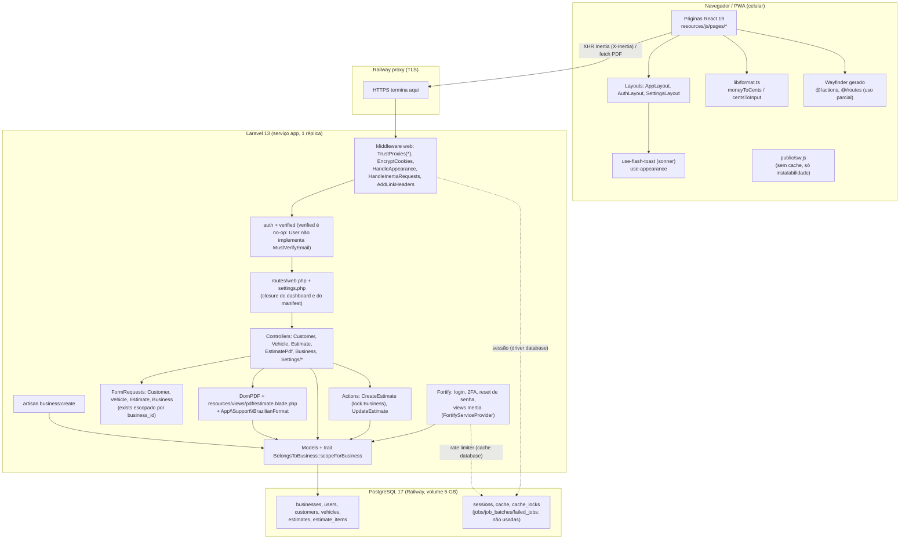
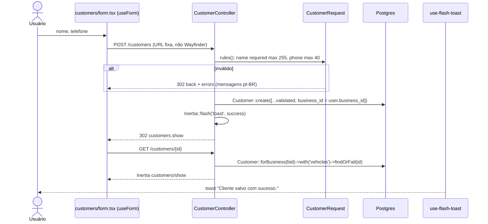

# Relatório — Laravel Architect (Tratto / Orçamentos)

Data: 2026-10-19 · Modo: somente leitura · Autor: agente laravel-architect

## 0. Aviso importante sobre a base analisada

- O working tree local está em `df32258` e **5 commits atrás de `origin/main`** (`git status -sb` → `main...origin/main [atrás 5]`). `origin/main` (`efebe2d`, 2026-10-04) é o que está em produção (deploy automático).
- A análise principal foi feita no working tree local; as diferenças de backend em `origin/main` foram lidas com `git diff HEAD origin/main` / `git show origin/main:<arquivo>` (sem alterar o working tree) e estão incorporadas abaixo, marcadas como **[origin]**.
- Diferenças relevantes em `origin/main`: rota `PATCH /estimates/{id}/status` (`EstimateController::status`), "duplicar" orçamento (`create?duplicate=`), pré-seleção por `vehicle_id`/`customer_id`, sugestões de itens (`itemSuggestions`), filtro `vehicle_id` no índice, onboarding no dashboard, `Vehicle::estimates()`, `SESSION_LIFETIME` padrão 43200 (30 dias), hook `use-unsaved-changes`, `tests/Feature/EstimateUsabilityTest.php` (inclui teste de 404 multi-tenant para o endpoint de status).

## 1. Escopo investigado

Backend: `routes/*`, `bootstrap/app.php`, `bootstrap/providers.php`, todos os controllers, Actions, FormRequests, Models, trait `BelongsToBusiness`, providers, middlewares, comando `business:create`, `BrazilianFormat`, migrations, config (fortify, mail, queue, cache, session, brand), view do PDF.
Frontend: `app.tsx`, `vite.config.ts`, páginas de login, clientes, veículos, orçamentos (form/show), hook `use-flash-toast`, `public/sw.js`.
Infra: `.github/workflows/tests.yml`, `.railway/railway.ts`, `docs/railway.md`, `docker-compose.yml`, `.env.example` (apenas chaves/valores de exemplo; `.env` não lido), `phpunit.xml`, `composer.json`, `package.json`/`package-lock.json`.
Execução: suíte Pest local (60 testes, 213 asserções, todos passando, sqlite em memória); `gh run list`/`gh run view --log-failed` (somente leitura) para o CI.

## 2. Arquitetura atual

### 2.1 Pacotes (versões instaladas)

`composer show --direct`:

| Pacote                                                                                                                                                                                | Versão  | Uso                                                                        |
| ------------------------------------------------------------------------------------------------------------------------------------------------------------------------------------- | ------- | -------------------------------------------------------------------------- |
| laravel/framework                                                                                                                                                                     | 13.31.0 | núcleo                                                                     |
| inertiajs/inertia-laravel                                                                                                                                                             | 3.3.4   | adaptador SPA                                                              |
| laravel/fortify                                                                                                                                                                       | 1.39.0  | autenticação headless                                                      |
| laravel/wayfinder                                                                                                                                                                     | 0.1.21  | geração de rotas TS                                                        |
| barryvdh/laravel-dompdf                                                                                                                                                               | 3.1.2   | PDF                                                                        |
| laravel/tinker                                                                                                                                                                        | 3.0.2   | REPL                                                                       |
| laravel/chisel                                                                                                                                                                        | 0.1.1   | resto do starter kit (não referenciado em `app/`, `config/`, `bootstrap/`) |
| dev: pestphp/pest 5.2.0, pest-plugin-laravel 5.0.1, phpunit 13.3.3, larastan 3.12.1, pint 1.32.1, boost 2.9.0, pail 1.2.7, sail 1.67.0, collision 8.9.5, mockery 1.6.15, faker 1.24.1 |         |                                                                            |

`package-lock.json`: `@inertiajs/react` 3.7.1, `@inertiajs/vite` 3.7.1, `react` 19.3.0, `vite` 8.3.0, `vite-plus` 0.3.0, `tailwindcss` 4.3.3, `typescript` 5.9.3, `laravel-vite-plugin` 3.2.0, `@laravel/vite-plugin-wayfinder` 0.1.10, `sonner` 2.0.8, Radix UI, `lucide-react`, `babel-plugin-react-compiler`, `railway` 3.11.0 (CLI/IaC, devDependency).

### 2.2 Flowchart da arquitetura



Camadas e dependências: Página React → (Inertia XHR) → middleware → controller → FormRequest (validação + escopo de oficina) → Action (transação) → Eloquent → Postgres. Não há camada de serviço/repositório além de 2 Actions; não há Policies (autorização = escopo `forBusiness` + `findOrFail`); não há eventos, observers, jobs, notifications próprias nem integrações externas.

## 3. Fluxos end-to-end

### 3.1 Login (Fortify)

```mermaid
sequenceDiagram
    actor U as Usuário
    participant P as auth/login.tsx (<Form {...store.form()}>)
    participant MW as Middleware web
    participant F as Fortify AuthenticatedSessionController
    participant RL as RateLimiter "login" (cache database)
    participant DB as Postgres (users, sessions)
    U->>P: e-mail + senha (+ lembrar)
    P->>MW: POST /login (Inertia XHR, CSRF)
    MW->>F: store()
    F->>RL: Limit 5/min por email|ip (FortifyServiceProvider:79-83)
    F->>DB: busca user por email, verifica hash
    alt 2FA confirmado
        F-->>P: redirect /two-factor-challenge (Inertia auth/two-factor-challenge)
        U->>P: código TOTP / recovery
        P->>F: POST /two-factor-challenge (limite 5/min por login.id)
    end
    F->>DB: regenera sessão (SESSION_DRIVER=database)
    F-->>P: 302 /dashboard (config fortify.home)
    P->>MW: GET /dashboard
    MW->>DB: closure routes/web.php: business + 5 últimos orçamentos
    MW-->>P: Inertia page "dashboard" + shared props (name, tagline, auth.user)
```



Evidências: `config/fortify.php:18,48,76,147-149`; `app/Providers/FortifyServiceProvider.php:41-84`; `resources/js/pages/auth/login.tsx:10,29-30`; `routes/web.php:38-43`.

### 3.2 Criar cliente



Evidências: `resources/js/pages/customers/form.tsx:16-20`; `app/Http/Controllers/CustomerController.php:29-44`; `app/Http/Requests/CustomerRequest.php:16`.

### 3.3 Criar veículo

```mermaid
sequenceDiagram
    actor U as Usuário
    participant P as vehicles/form.tsx
    participant V as VehicleController
    participant R as VehicleRequest
    participant DB as Postgres
    U->>P: abre /vehicles/create?customer_id=X
    P->>V: GET create
    V->>DB: clientes da oficina (id, name); valida customer_id da query contra a lista
    V-->>P: Inertia vehicles/form {customers, selectedCustomerId}
    U->>P: modelo, placa, cor
    P->>V: POST /vehicles
    V->>R: customer_id exists em customers WHERE business_id = bid; model req; plate max 16
    V->>DB: Vehicle::create([...validated, business_id, plate = strtoupper(plate) ?: null])
    V-->>P: flash toast + 302 customers.show(customer_id)
```

Evidências: `app/Http/Controllers/VehicleController.php:14-33`; `app/Http/Requests/VehicleRequest.php:18-21`.

### 3.4 Criar / editar orçamento

```mermaid
sequenceDiagram
    actor U as Usuário
    participant P as estimates/form.tsx (useForm)
    participant E as EstimateController
    participant R as EstimateRequest
    participant A as CreateEstimate / UpdateEstimate
    participant DB as Postgres
    U->>P: GET /estimates/create (ou /{id}/edit)
    P->>E: create()/edit()
    E->>DB: formData: TODOS os clientes e veículos da oficina [origin: + itemSuggestions, duplicate, selected*]
    E-->>P: Inertia estimates/form
    U->>P: cliente, veículo, data, status, itens (R$)
    P->>P: transform: amount = moneyToCents(input)
    P->>E: POST /estimates  ou  PUT /estimates/{id}
    E->>R: customer_id/vehicle_id exists escopados; 1..100 itens; amount int 1..999999999
    R->>DB: after(): Vehicle::forBusiness->find; customer_id do veículo == customer_id
    alt store
        E->>A: CreateEstimate::handle(business, validated)
        A->>DB: BEGIN; SELECT businesses FOR UPDATE; max(number)+1
        A->>DB: INSERT estimate (total = soma amounts); INSERT items; COMMIT
    else update
        E->>DB: Estimate::forBusiness->findOrFail(id)
        E->>A: UpdateEstimate::handle(estimate, validated)
        A->>DB: BEGIN; UPDATE estimate (total recalculado); DELETE items; INSERT items; COMMIT
    end
    E-->>P: flash toast + 302 estimates.show
    Note over P,E: [origin] PATCH /estimates/{id}/status muda draft/sent (validação inline, escopado)
```

Evidências: `app/Http/Controllers/EstimateController.php:30-53,62-79`; `app/Actions/CreateEstimate.php:11-28`; `app/Actions/UpdateEstimate.php:10-24`; `app/Http/Requests/EstimateRequest.php:16-39`; `resources/js/pages/estimates/form.tsx:127-139`.

### 3.5 Gerar PDF

```mermaid
sequenceDiagram
    actor U as Usuário
    participant S as estimates/show.tsx
    participant PC as EstimatePdfController
    participant DB as Postgres
    participant D as DomPDF
    U->>S: "Baixar PDF" ou "Compartilhar"
    S->>PC: fetch GET /estimates/{id}/pdf (cookie de sessão, fora do Inertia)
    PC->>DB: Estimate::forBusiness(bid)->with(customer, vehicle, items, business)->findOrFail
    PC->>D: loadView('pdf.estimate') A4, DejaVu Sans, BrazilianFormat
    D-->>PC: bytes PDF (síncrono, sem salvar em disco)
    PC-->>S: 200 application/pdf (attachment orcamento-NNN.pdf)
    alt navigator.canShare(files)
        S->>U: Web Share API [origin: marca status=sent ao concluir]
    else
        S->>U: download via blob URL
    end
    Note over S: response.ok é o único teste; content-type não é verificado
```

Evidências: `app/Http/Controllers/EstimatePdfController.php:12-20`; `resources/js/pages/estimates/show.tsx:51-110`; `resources/views/pdf/estimate.blade.php` (89 linhas, `{{ }}` escapado).

## 4. Inventário de jobs, filas, schedulers e integrações

| Item                             | Situação                                                                                                                    | Evidência                                                                               |
| -------------------------------- | --------------------------------------------------------------------------------------------------------------------------- | --------------------------------------------------------------------------------------- |
| Jobs (`ShouldQueue`, `dispatch`) | **Nenhum**                                                                                                                  | grep em `app/`, `routes/` sem ocorrências                                               |
| Filas                            | Config `database` por padrão; tabelas `jobs`, `job_batches`, `failed_jobs` criadas mas não usadas; nenhum worker no Railway | `config/queue.php:16`, migration `0001_01_01_000002`, `.railway/railway.ts` (1 serviço) |
| Scheduler                        | **Nenhum** (só `inspire` em `routes/console.php`)                                                                           | `routes/console.php`                                                                    |
| Eventos/observers/listeners      | Nenhum próprio                                                                                                              | —                                                                                       |
| Notifications/Mail               | Só as do Fortify (reset de senha); `MAIL_MAILER` padrão `log`; nenhuma variável `MAIL_*` declarada em `.railway/railway.ts` | `config/mail.php:17`, `.railway/railway.ts`                                             |
| HTTP externo                     | Nenhum (`Http::` sem uso); DomPDF com `enable_remote=false`                                                                 | `vendor/barryvdh/laravel-dompdf/config/dompdf.php:270`                                  |
| Armazenamento                    | Nenhum upload; PDF não persistido                                                                                           | `docs/railway.md`                                                                       |
| Fontes                           | Bunny Fonts via `laravel-vite-plugin/fonts` (build)                                                                         | `vite.config.ts`                                                                        |
| Observabilidade                  | Logs `stderr` no Railway; sem APM/Sentry; healthcheck `/up` (não verifica DB)                                               | `docs/railway.md`, `bootstrap/app.php:15`                                               |

Conclusão: confirmado — não há jobs, filas ativas, schedulers nem integrações externas de runtime.

## 5. Tratamento de erros

- Backend: `bootstrap/app.php:28-32` só define `shouldRenderJsonWhen` para `api/*` / `expectsJson`. Nenhum handler customizado, nenhuma página de erro Inertia (sem `resources/js/pages/errors`).
- Validação: FormRequests com `messages()` em pt-BR + `lang/pt_BR`; erros voltam via sessão (Inertia `errors`).
- 404 multi-tenant: `findOrFail` escopado → `ModelNotFoundException` → 404 padrão do Laravel.
- Frontend (`resources/js/hooks/use-flash-toast.ts`): `httpException` com status ≥ 500 → toast genérico; `networkError` → toast de conexão. Status 4xx (404, 403, 419 CSRF expirado) **não** são tratados: o Inertia exibe a página HTML do Laravel no modal padrão.
- PDF: `fetch` com `response.ok`; falhas → toast. Redirect para `/login` (sessão expirada) devolve 200 HTML e seria salvo como `.pdf` (hipótese, ver H3).
- Integridade: `estimates.customer_id/vehicle_id` com `restrictOnDelete`; `unique(business_id, number)`; transação em create/update.

## 6. CI/CD e ambiente de dev

- **CI** (`.github/workflows/tests.yml`): push em `main` e PRs; PHP 8.5, Node 22; `composer setup` (copia `.env.example`, `migrate --force`, `npm install`, `npm run build`) e `composer ci:check` (`vp check`, `tsc`, pint --test, phpstan level 0, `php artisan test`). Actions pinadas por SHA, `permissions: contents: read`, Dependabot ativo.
- **CD**: Railway ligado ao GitHub; todo push em `main` → build Railpack → pre-deploy `php artisan migrate --force` → healthcheck `/up` (300 s). IaC em `.railway/railway.ts` (serviço `app` 1 réplica + Postgres com volume 5 GB em `us-east4`), variáveis com `preserve()`. O CI **não** bloqueia o deploy (`docs/railway.md`, seção Cuidados).
- **Dev**: `docker-compose.yml` (Postgres 17 em `localhost:5434`), `composer run dev` → `php artisan dev` (orquestra servidor, Vite etc.), Sail instalado mas não usado, `DemoSeeder` via `DatabaseSeeder`. Testes: sqlite `:memory:`, `QUEUE_CONNECTION=sync`, `MAIL_MAILER=array` (`phpunit.xml`).

## 7. Achados confirmados

| #   | Sev.   | Achado                                                                                                                                                                                                                                                                                                                                                               | Evidência                                                                                                                                                                                                                                                                                                                                | Impacto                                                                               | Confiança                                              | Esforço                                                                                                                                                                                                                       |
| --- | ------ | -------------------------------------------------------------------------------------------------------------------------------------------------------------------------------------------------------------------------------------------------------------------------------------------------------------------------------------------------------------------- | ---------------------------------------------------------------------------------------------------------------------------------------------------------------------------------------------------------------------------------------------------------------------------------------------------------------------------------------- | ------------------------------------------------------------------------------------- | ------------------------------------------------------ | ----------------------------------------------------------------------------------------------------------------------------------------------------------------------------------------------------------------------------- |
| A1  | **P1** | **CI quebrado em todo push na `main`**: `composer setup` copia `.env.example` com `DB_CONNECTION=pgsql`/porta 5434 e roda `migrate --force`, mas o workflow não sobe Postgres. Falha antes dos testes. Como o deploy é automático e não depende do CI, **não há nenhum gate automatizado** antes da produção.                                                        | `.github/workflows/tests.yml:34-38`; `composer.json` script `setup`; `.env.example` (`DB_CONNECTION=pgsql`, `DB_PORT=5434`); `gh run view 37167447342 --log-failed` → "Script @php artisan migrate --force handling the setup event returned with error code 1"; runs 34968964436, 34975462510, 37167447342, 38495597737 todos `failure` | Regressões chegam à produção sem verificação; checks de lint/tipos/testes nunca rodam | Alta (comprovado por logs)                             | Baixo: adicionar `services: postgres` ao job, ou rodar em sqlite (`DB_CONNECTION=sqlite` + `touch database/database.sqlite`) no CI; idealmente exigir CI verde antes do deploy (branch protection + "Wait for CI" no Railway) |
| A2  | P2     | `businesses.address` é `varchar(255)` mas `BusinessRequest` aceita até 500 caracteres. No Postgres, 256–500 chars → erro SQL 22001 → 500 (toast genérico). Os testes (sqlite) não detectam porque sqlite ignora o tamanho.                                                                                                                                           | `database/migrations/0001_01_01_000000_create_users_table.php:20`; `app/Http/Requests/BusinessRequest.php:21`                                                                                                                                                                                                                            | Usuário não consegue salvar endereço longo; erro opaco                                | Alta                                                   | Baixo: `max:255` no request (ou nova migration para `text`)                                                                                                                                                                   |
| A3  | P2     | Editar o veículo permite trocar `customer_id`; orçamentos existentes daquele veículo mantêm o `customer_id` antigo → `estimate.customer_id ≠ vehicle.customer_id`, violando o invariante que `EstimateRequest::after()` impõe na criação. Editar esse orçamento depois falha na validação até trocar o cliente.                                                      | `app/Http/Controllers/VehicleController.php:44-47`; `app/Http/Requests/VehicleRequest.php:18`; `app/Http/Requests/EstimateRequest.php:30-41`                                                                                                                                                                                             | PDF/listagens mostram cliente inconsistente com o veículo; dado histórico ambíguo     | Alta (código)                                          | Baixo–médio: bloquear troca de cliente se houver orçamentos, ou decidir regra de negócio                                                                                                                                      |
| A4  | P2     | Middleware `verified` é no-op: `User` não implementa `MustVerifyEmail` (import comentado), embora `Features::emailVerification()` esteja ativo e haja página `auth/verify-email`. Código/rotas de verificação são mortos; troca de e-mail zera `email_verified_at` sem efeito.                                                                                       | `app/Models/User.php:5`; `config/fortify.php:148`; `routes/web.php` grupo `['auth','verified']`; `app/Http/Controllers/Settings/ProfileController.php` `update`                                                                                                                                                                          | Falsa sensação de controle; complexidade acidental                                    | Alta                                                   | Baixo: remover feature/middleware ou implementar a interface (decisão de produto)                                                                                                                                             |
| A5  | P2     | Autoexclusão de conta (`DELETE settings/profile`) disponível. Se for o único usuário, a `Business` e todos os dados ficam órfãos e sem acesso; não há cadastro público, só `business:create` via SSH.                                                                                                                                                                | `routes/settings.php:16`; `ProfileController::destroy`; `users.business_id` cascade só na direção business→users                                                                                                                                                                                                                         | Perda de acesso irreversível pelo produto; suporte manual                             | Alta (código)                                          | Baixo: remover a rota ou impedir exclusão do último usuário                                                                                                                                                                   |
| A6  | P2     | Listagens sem paginação: `customers.index` e `estimates.index` usam `->get()`; o form de orçamento carrega todos os clientes e veículos da oficina a cada abertura.                                                                                                                                                                                                  | `CustomerController.php:17-19`; `EstimateController.php:21-24, 73-80`                                                                                                                                                                                                                                                                    | Payload Inertia cresce linearmente; lento no celular com histórico grande             | Alta (código); impacto depende do volume               | Médio: `paginate()`/infinite scroll do Inertia 3; busca assíncrona de clientes                                                                                                                                                |
| A7  | P3     | Busca com `strtolower` (byte/ASCII) no PHP contra `lower()` do Postgres: termo com maiúscula acentuada ("JOÃO") não casa com "João". Curingas `%`/`_` não escapados. Lógica duplicada em 2 controllers.                                                                                                                                                              | `CustomerController.php:18`; `EstimateController.php:23`                                                                                                                                                                                                                                                                                 | Busca falha em casos com acento maiúsculo                                             | Alta (semântica do PHP 8)                              | Baixo: `mb_strtolower` + escape, extrair scope `search`                                                                                                                                                                       |
| A8  | P3     | Relação `Estimate::items()` sem `orderBy`; `UpdateEstimate` apaga e recria itens. No Postgres a ordem sem `ORDER BY` não é garantida (normalmente segue inserção).                                                                                                                                                                                                   | `app/Models/Estimate.php:32-35`; `app/Actions/UpdateEstimate.php:19-20`                                                                                                                                                                                                                                                                  | Ordem de itens no PDF/tela pode variar                                                | Média (plausível na prática; contrato SQL não garante) | Baixo: `->orderBy('id')` (ou coluna `position`)                                                                                                                                                                               |
| A9  | P3     | `business:create` aceita senha `min:8`, ignorando `Password::defaults()` forte de produção (12+, símbolos, uncompromised).                                                                                                                                                                                                                                           | `app/Console/Commands/CreateBusinessCommand.php:37`; `AppServiceProvider.php`                                                                                                                                                                                                                                                            | Primeira senha da oficina pode ser fraca                                              | Alta                                                   | Baixo: usar `Password::defaults()`                                                                                                                                                                                            |
| A10 | P3     | Convenção Wayfinder descumprida: ~27 URLs fixas (`/estimates/${id}`, `/customers/create`, etc.) em páginas vs 16 imports de `@/actions`/`@/routes`.                                                                                                                                                                                                                  | `resources/js/pages/*/form.tsx`, `estimates/show.tsx:51,141`; `docs/sistema.md` seção Frontend                                                                                                                                                                                                                                           | Rotas renomeadas quebram silenciosamente; perde type-safety                           | Alta                                                   | Médio                                                                                                                                                                                                                         |
| A11 | P3     | Data padrão do orçamento usa UTC: `new Date().toISOString().slice(0,10)` → após 21h em Brasília grava o dia seguinte.                                                                                                                                                                                                                                                | `resources/js/pages/estimates/form.tsx:59` (local) / `:88` [origin]                                                                                                                                                                                                                                                                      | Data errada no orçamento noturno                                                      | Alta                                                   | Baixo: data local ou default no servidor (`now()->toDateString()` com `APP_TIMEZONE`)                                                                                                                                         |
| A12 | P3     | Resíduos do starter kit/complexidade acidental: `laravel/chisel` em `require` (prod) sem uso; `composer.json` com nome `laravel/react-starter-kit`; tabelas de fila; caso `'welcome'` em `app.tsx` sem página; `HandleInertiaRequests::version` trivial; Sail instalado mas não usado; closures de negócio em `routes/web.php` (dashboard e, em origin, onboarding). | `composer.json`; `resources/js/app.tsx:12-13`; `routes/web.php:38-43`                                                                                                                                                                                                                                                                    | Ruído e superfície de manutenção                                                      | Alta                                                   | Baixo                                                                                                                                                                                                                         |
| A13 | P3     | Node 22 no CI vs "Node 24+" documentado.                                                                                                                                                                                                                                                                                                                             | `.github/workflows/tests.yml:30`; `docs/sistema.md`                                                                                                                                                                                                                                                                                      | Divergência de ambiente                                                               | Alta                                                   | Trivial                                                                                                                                                                                                                       |

Pontos positivos confirmados: isolamento multi-tenant consistente (todos os `find` escopados, `exists` escopado nos requests, `business_id` nunca vindo do request); numeração com `lockForUpdate` dentro de transação; total calculado no servidor; dinheiro em centavos inteiros; mensagens pt-BR; PDF escapado e sem recursos remotos; testes de 404 cross-tenant inclusive para o novo endpoint de status [origin].

## 8. Hipóteses não verificadas

- **H1 (P2 provável): reset de senha não funciona em produção** e o link/token é escrito nos logs. `MAIL_MAILER` padrão é `log` e `.railway/railway.ts` não lista nenhuma variável `MAIL_*`, mas não vi o painel do Railway. A tela de login oferece "Esqueci minha senha".
- **H2:** sem cast de `customer_id` em `Vehicle`, a comparação estrita em `EstimateRequest::after()` (`!==` contra `$this->integer()`) depende de o PDO devolver `int`. Com PHP 8.5 + pdo_pgsql/pdo_sqlite isso ocorre (testes passam), mas um cast explícito eliminaria o risco.
- **H3:** com sessão expirada, o `fetch` do PDF segue o redirect para `/login` e recebe HTML 200, que seria salvo como `.pdf`. Mitigado pela sessão de 30 dias [origin], mas não tratado.
- **H4:** 4xx em visitas Inertia (419 CSRF, 404) aparecem no modal HTML padrão em vez de toast pt-BR.
- **H5:** a sessão de 30 dias [origin] + 2FA opcional aumenta a janela de uso de um celular perdido; aceitável para o público, mas é decisão de segurança.
- **H6:** concorrência no `UpdateEstimate` (sem lock): duas edições simultâneas → last-write-wins sem conflito detectado. Baixo risco no uso real.

## 9. Recomendações (ordem sugerida)

1. Consertar o CI (A1) e torná-lo bloqueante para o deploy (branch protection em `main` + "Wait for CI" no Railway, ou deploy só a partir de PR mergeado).
2. Corrigir A2 (`max:255`) e decidir a regra de A3 (troca de dono do veículo).
3. Remover autoexclusão de conta ou proteger o último usuário (A5); limpar o `verified`/emailVerification ou implementá-lo (A4).
4. Confirmar mailer de produção (H1); se não houver SMTP, desativar `resetPasswords()` e documentar o procedimento manual.
5. Paginação/infinite scroll nas listas e busca assíncrona de clientes no form (A6) antes de o volume crescer.
6. Extrair um scope `search()` reutilizável com `mb_strtolower` e escape (A7); `orderBy('id')` nos itens (A8).
7. Migrar URLs fixas para Wayfinder (A10) aos poucos; usar `Password::defaults()` no comando (A9); data local (A11).
8. Limpeza de resíduos (A12), alinhar Node (A13). Considerar elevar PHPStan acima do level 0.

## 10. Testes necessários

- Postgres no CI (ou ao menos um job) para pegar erros de tamanho de coluna e diferenças de `lower()`/ordem que o sqlite mascara (A2, A7, A8).
- `BusinessRequest`: endereço com 256+ caracteres retorna erro de validação, não 500.
- Veículo: tentativa de trocar o cliente de um veículo com orçamentos (comportamento definido em A3).
- Perfil: não permitir excluir o último usuário da oficina (A5) ou garantir que a rota não existe.
- `business:create` rejeita senha fraca em produção (A9).
- Itens do orçamento retornam na ordem de inserção após update (A8).
- Busca com termo acentuado em maiúsculas (A7).

## 11. Riscos e limitações

- Working tree local 5 commits atrás de produção; backend de `origin/main` revisado via diff, frontend novo apenas por amostragem (grep).
- Não acessei Railway nem `.env`; achados de infraestrutura de produção (H1) são inferidos do IaC e da documentação.
- Durante a execução, a suíte Pest falhou uma vez com `TestCaseAlreadyInUse` por causa de `tests/Feature/ZzDomainProbeTest.php`, criado por outro agente no repositório; o arquivo já tinha sido removido na verificação seguinte. A suíte sem esse arquivo passou (60 testes). Recomendo garantir que os agentes não escrevam no repositório.
- O Codex CLI não foi usado nesta análise.

## 12. Perguntas para outros agentes

- **Segurança:** confirmar H1 (mailer/log de tokens) e avaliar H5 (sessão de 30 dias); revisar exposição de `auth.user` completo nas shared props.
- **Domínio/produto:** a troca de cliente de um veículo (A3) deve ser permitida? Orçamento "enviado" deve ficar imutável ou ter histórico?
- **Frontend:** plano de migração para Wayfinder (A10) e tratamento de 4xx/419 (H4); validar o hook `use-unsaved-changes` [origin].
- **DevOps:** qual estratégia preferida para o gate (Postgres service no Actions vs sqlite) e se o Railway pode esperar o CI.
- **Performance:** volume real por oficina (clientes/orçamentos) para priorizar A6.
